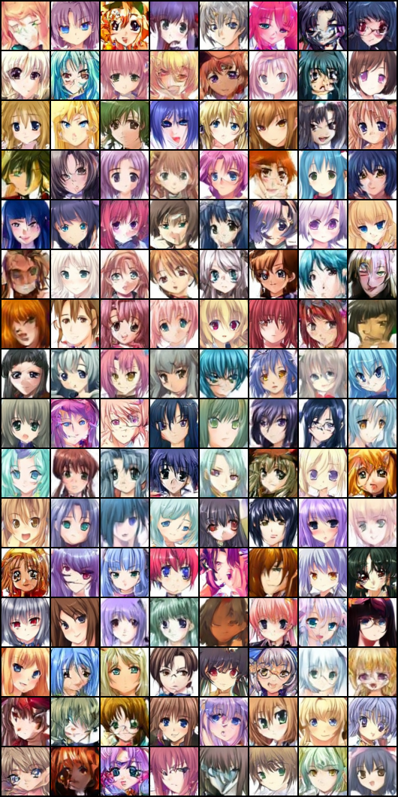
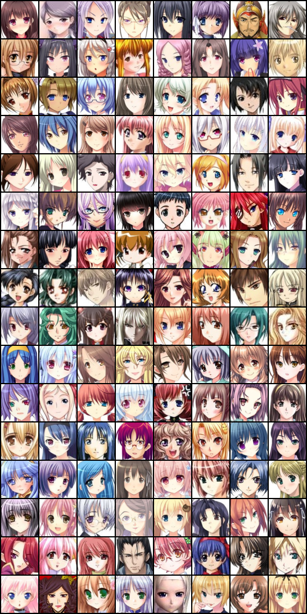

# 🎨 DDPM Anime Face 模型评估报告

> **生成时间**: 2026-11-09 16:09:40
> **模型架构**: UNet (base_ch=64) + Cosine β Schedule + EMA
> **参数量**: 8.77M
> **分辨率**: 64×64

## 📊 核心评估指标对比

| 指标 | 生成数据 (Generated) | 真实数据 (Real) | 比值 (Gen/Real) | 判定 |
| :--- | :--- | :--- | :--- | :--- |
| **多样性 (Diversity)** | 72.19 | 73.89 | **0.98** | ✅ 优秀 (0.7~1.0) |
| **锐度 (Sharpness)** | 0.1294 | 0.1500 | **0.86** | ✅ 优秀 (0.7~1.2) |

*注：Diversity 越接近真实值越好，过高说明充满噪点，过低说明模式塌缩。Sharpness 过高通常意味着生成图像带有大量像素噪点。*

## 🖼️ 视觉采样展示

| 模型生成 (128 张) | 真实数据集 (128 张) |
| :---: | :---: |
|  |  |

## 📝 训练结论
1. **收敛状态良好**：Loss 稳定在 0.042 左右，模型已达到理论收敛极限。
2. **多样性健康**：生成数据的 Diversity 达到了真实数据的 97.7%，表明模型**没有发生模式塌缩**（Mode Collapse）。
3. **画质平滑**：Sharpness 是真实数据的 86.3%，说明生成的二次元图像边缘清晰、色块纯净，没有高频的噪点伪影。

*此报告由自动化脚本生成，所有数据均基于当前加载的 Checkpoint。*
